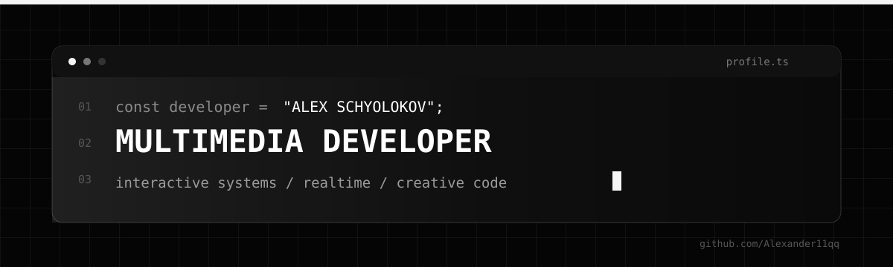

<p align="center">
  
</p>

<p align="center">
  <a href="https://t.me/scholok">
    
  </a>
</p>

<br/>

## `01 / ОБО МНЕ · ABOUT`

**RU**

Я — **Alex Schyolokov**, multimedia developer. Создаю интерактивные системы на пересечении кода, изображения, звука и пространства.

> Однажды начал изучать интерактивные технологии и не смог остановиться.

**EN**

I'm **Alex Schyolokov**, a multimedia developer building interactive systems at the intersection of code, visuals, sound, and space.

> Once I started exploring interactive technologies — and never stopped.

<br/>

## `02 / ФОКУС · FOCUS`

```text
interactive systems  /  realtime graphics  /  creative coding
audiovisual tools    /  media pipelines    /  human interaction
```

- Интерактивные и аудиовизуальные системы · Interactive and audiovisual systems
- Графика и данные в реальном времени · Real-time graphics and data
- Creative coding и прототипирование · Creative coding and prototyping
- Интеграция мультимедийного оборудования · Multimedia hardware integration
- Локальные AI-инструменты для медиасреды · Local AI tools for media workflows

<br/>

## `03 / ИНСТРУМЕНТЫ · TOOLBOX`

<table>
<tr>
<td width="50%" valign="top">

### `AI & SPEECH`

<p>
  
  
  
</p>

Распознавание речи, локальные AI-пайплайны и инструменты для обработки медиаданных.

</td>
<td width="50%" valign="top">

### `REAL-TIME & MULTIMEDIA`

<p>
  
  
  
  
</p>

Интерактивная графика, creative coding и аудиовизуальные системы реального времени.

</td>
</tr>
<tr>
<td width="50%" valign="top">

### `GAME ENGINES`

<p>
  
  
</p>

Интерактивные приложения, real-time 3D и разработка логики на C#.

</td>
<td width="50%" valign="top">

### `SYSTEMS & ENGINEERING`

<p>
  
  
  
</p>

Интеграция оборудования, архитектура проектов и устойчивые production-системы.

</td>
</tr>
</table>

<br/>

## `04 / ПОДХОД · APPROACH`

```text
idea
  └── experiment
        └── prototype
              └── reliable system
                    └── experience
```

Мне интересно превращать технологию в понятный опыт: сначала исследовать идею, затем быстро собрать прототип и довести его до устойчивой системы.

I enjoy turning technology into a clear experience: exploring an idea, prototyping it quickly, and developing it into a reliable system.

<br/>

## `05 / СВЯЗЬ · CONTACT`

<p>
  <strong>Telegram</strong> · <a href="https://t.me/scholok">@scholok</a>
</p>

<sub>Public projects will appear here when they are ready. Until then, the work stays private — the curiosity does not.</sub>
